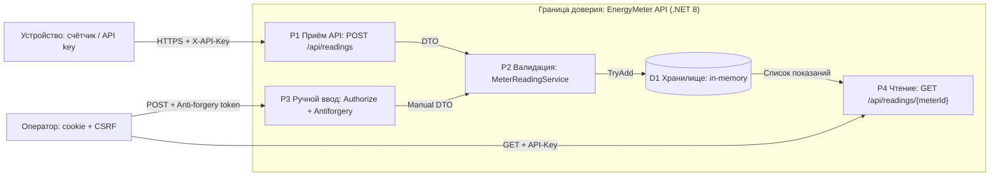

# DFD уровня 1 — EnergyMeter System

Граница доверия охватывает сервер EnergyMeter API на ASP.NET Core .NET 8. Устройства передают показания через API-ключ, а браузерный кабинет использует cookies и защиту от CSRF. БД и реальная система входа пока не интегрированы.

Слои защиты: Swagger только Development; API-ключ для устройств; `[Authorize]` и anti-forgery проверка для cookie-действия; TLS в промышленной среде; журналы и мониторинг. **Учебные ограничения:** нет Identity Provider и постоянной Production-БД.

Структурная DFD изображена в оригинальном Word-отчёте ПР7; этот Mermaid-граф — дополнительный редактируемый вариант схемы.
